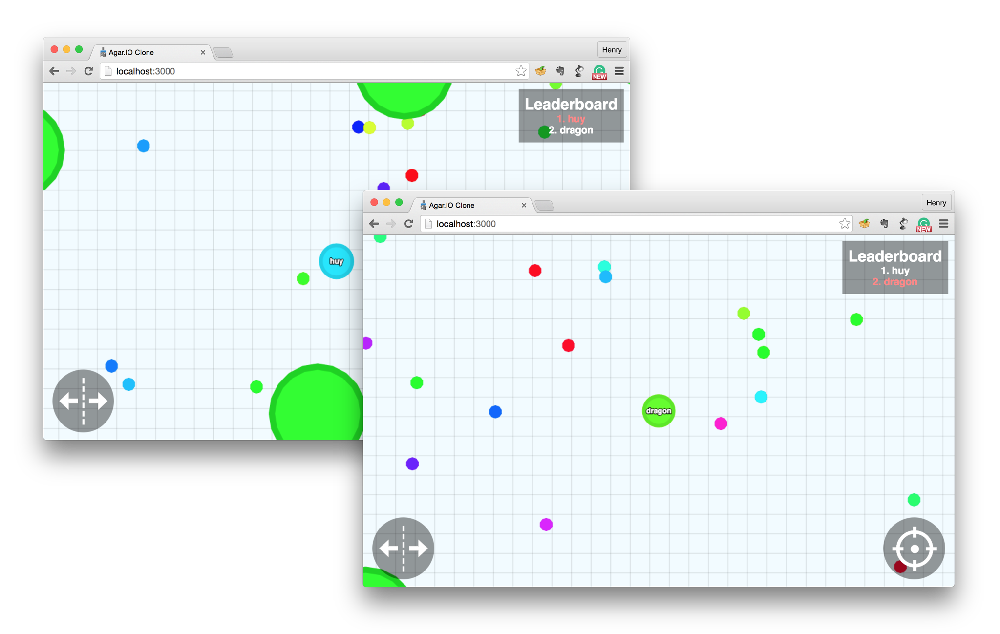

Agar.io Clone
=============

This project was originally created by @huytd. I have since taken ownership of the repository to revive the project.

[](https://github.com/huytd/agar.io-clone/stargazers)
[](https://github.com/huytd/agar.io-clone/issues)
[](https://github.com/huytd/agar.io-clone/wiki/Home)
[](#live-demos)
[](https://gitter.im/huytd/agar.io-clone?utm_source=badge&utm_medium=badge&utm_campaign=pr-badge&utm_content=badge)

A simple but powerful Agar.IO clone built with TCP sockets and HTML5 canvas on top of NodeJS.



## Live Demos
An updated live list of demos can be found on the [Live Demos wiki page](https://github.com/owenashurst/agar.io-clone/wiki/Live-Demos).

This is the most up to date version from master. Any merged pull requests will deploy to this URL automatically.

---

## How to Play
You can check out how to play on our [wiki](https://github.com/owenashurst/agar.io-clone/wiki/How-to-Play).

#### Game Basics
- Move your mouse around the screen to move your cell.
- Eat food and other players in order to grow your character (food respawns every time a player eats it).
- A player's **mass** is the number of food particles eaten.
- **Objective**: Try to get as big as possible and eat other players.

#### Gameplay Rules
- Players who haven't eaten yet cannot be eaten as a sort of "grace" period. This invincibility fades once they gain mass.
- Everytime a player joins the game, **3** food particles will spawn.
- Everytime a food particle is eaten by a player, **1** new food particle will respawn.
- The more food you eat, the slower you move to make the game fairer for all.

---

## Latest Changes
- Game logic is handled by the server
- The client side is for rendering of the canvas and its items only.
- Mobile optimisation.
- Implementation of working viruses.
- Display player name.
- Now supporting chat. 
- Type`-ping` in the chatbox to check your ping, as well as other commands!

---

## Installation
You can simply click one of the buttons below to easily deploy this repo to Bluemix or Heroku:

[](https://heroku.com/deploy)

Or...

>You can check out a more detailed setup tutorial on our [wiki](https://github.com/owenashurst/agar.io-clone/wiki/Setup).

#### Requirements
To run / install this game, you'll need: 
- NodeJS with NPM installed.
- Express.
- Electron (the desktop client; installed automatically by `npm install`).


#### Downloading the dependencies
After cloning the source code from Github, you need to run the following command to download all the dependencies (Express, etc.):

```
npm install
```

#### Running the Server
After downloading all the dependencies, you can run the server with the following command:

```
npm start
```

The HTTP server and the TCP game listener start with `npm start`. The HTTP server listens on `http://localhost:3000` (configurable) and serves the client assets; launch the Electron client to play. The default TCP game port is `3001`, however this can be changed in config. Further elaboration is available on our [wiki](https://github.com/owenashurst/agar.io-clone/wiki/Setup).

Game traffic uses the raw TCP listener from the custom socket module. It listens on `config.tcp` (default `127.0.0.1`/`0.0.0.0` port `3001`) and is the only game transport. The HTTP server serves the static client assets, but a plain browser tab cannot connect to the game because browsers cannot open raw TCP connections; use the Electron desktop client.

#### Desktop client (Electron)

The Electron client keeps the TCP connection in the main process and exposes a narrow IPC bridge to the renderer. The renderer keeps `contextIsolation` enabled, Node integration disabled and sandboxing on, so it never touches `net` or the raw socket.

Build the client assets first, then launch Electron against a running game server:

```
npm install
npm run build
npm run electron
```

`AGAR_SERVER_HOST` and `AGAR_SERVER_PORT` select the server the desktop client connects to (default `127.0.0.1` and `config.tcp.port`). `npm run electron:dev` rebuilds and launches in one step. The server must already be running, for example with `npm start`.

The renderer uses the same `emit`/`on`/`close` surface through `src/client/js/transport`. The transport is the Electron IPC bridge backed by `TcpClient` in the main process. Reconnects are handled there, and a renderer reload starts a fresh TCP session so it receives its own `welcome`. Running the client in a plain browser does not create a game connection.

The renderer bundles its jQuery copy from `src/client/vendor`, so the desktop app does not need network access to load its UI.

Run the automated desktop end-to-end test (requires a display, or `xvfb-run`) with:

```
npm run build
npm run test:e2e
```

It starts a temporary server and SQLite database, opens a real Electron window with the production preload, and exercises register, room creation, a second TCP player, ready/start, gameplay updates, match end, return to lobby and disconnect/reconnect. Override the default mirror with `ELECTRON_MIRROR` if Electron binaries cannot be fetched from the default host.

The protocol test drives the transport directly. To exercise the actual screens and buttons instead, run the UI-driven end-to-end test:

```
npm run build
npm run test:e2e:ui
```

It registers through the auth form, creates a room through the lobby, changes room settings, joins a second player over TCP, readies up, starts and stops the match, returns to the room, leaves it, logs out, continues as a guest, and checks the legacy quick play and spectate paths.

Package the desktop app with:

```
npm run package
```

The output is written to `dist/OpenAgar-<platform>-<arch>` and includes an asar bundle of the renderer and Electron main/preload code. `AGAR_PACKAGE_PLATFORM` and `AGAR_PACKAGE_ARCH` override the target platform and architecture.

#### Client UI

The renderer now includes the full account, lobby, room and match UI:

- **Auth:** log in, register, or continue as a guest. Inline errors cover bad credentials and validation. A stored token resumes the account after a reload; fatal session errors clear it and return to the auth screen.
- **Lobby:** lists public rooms with public/private and player-count metadata. Rooms can be joined by button or by code, spectated, created, refreshed, and filtered by the server. Empty, loading and error states are handled.
- **Room:** shows the player and spectator rosters, per-player ready state and owner badge, a countdown, and owner-only settings (name, visibility, max players, map size, time/score limits) plus delete. Players ready up and the owner starts when everyone is ready.
- **Match:** the canvas, HUD and chat are reused from the existing renderer. The HUD shows the room and a leave button; the owner can stop the match. The game-over overlay lists ranked scores and the end reason, and the owner can return the room to the lobby.
- **Legacy links:** quick play and spectate still connect to the default non-room game. Spectate uses the server's `type=spectator` handlers, so it never creates a playable cell.

The UI logic is split into `src/client/js/app.js` (transport and lifecycle wiring), `src/client/js/app-ui.js` (DOM screens and controls), `src/client/js/room-store.js` (room/roster/match reducer), `src/client/js/session-store.js` (persisted account token and guest name) and `src/client/js/ui-format.js` (display formatting helpers). Transport selection stays in `src/client/js/transport/`, and the client runs over the Electron TCP bridge.

#### Accounts and sessions

Accounts are stored in SQLite (`config.sqlinfo`). Clients can authenticate over either transport:

- `register` / `login` with `{ username, password }` returns `authOk` with an account and session token, or `authError` with a stable code.
- `auth` / `resumeSession` with a token resumes the session after a reconnect.
- `logout` revokes the current token.
- TCP clients can pass the token in the handshake: `createClient({ ..., auth: { token } })`.

Guest play remains enabled. Session lifetime, password rules, duplicate-login behavior and rate limits are configured under `config.auth`.

#### Lobby rooms

The server keeps a lobby of in-memory rooms. Clients can list rooms, create public or private rooms, change settings (owner only), and delete their room. Room ids are opaque; each room also has a short join code. Empty rooms are removed after `config.rooms.emptyRoomGraceMs`. Room settings cover map size, food/virus limits, mass values, max players and time/score limits.

Clients join with `joinRoom` (`id`, or `code` for a private room) and leave with `leaveRoom`. A join returns a `roomSnapshot` and room occupants receive `playerJoined` / `playerLeft` events. A player can only be in one room at a time. Spectators can join without a playable cell. Account memberships survive a short disconnect (`config.rooms.disconnectGraceMs`) and are restored on reconnect; guest memberships are removed immediately. When the owner leaves, ownership transfers to the next occupant, and the room closes when the last occupant leaves.

#### Disconnects, reconnects and shutdown

- A disconnect maps to `account:<id>` or `guest:<socket.id>` and only affects that member's room.
- Room occupants receive `playerDisconnect` with `{ roomId, memberId, accountId, name, role, reason, graceMs }`. Guests have `graceMs: 0` and are removed at once; accounts keep their membership for `config.rooms.disconnectGraceMs` and their readiness is cleared in the lobby.
- A disconnected player's cell stays in the world to reserve its mass and position but is frozen, so it cannot move or eat during the grace period. `gameState` and final result entries expose a `disconnected` flag.
- Reconnecting with the same account token restores the membership and cell, then broadcasts `playerReconnect` with `{ roomId, memberId, accountId, name, role }`.
- An app-level heartbeat timeout (`config.maxHeartbeatInterval`) uses the same policy: the socket gets a `kick` event, the room sees `playerDisconnect` with reason `heartbeat timeout`, and the grace timer is forced to run.
- When grace expires the member is removed with reason `disconnect timeout` (or `heartbeat timeout`). During a running match the player is marked DNF and the match can finish with `not_enough_players`. If the owner is removed, ownership transfers to the next occupant.
- A socket that switches from the default game into a room is removed from the default game, so the default heartbeat cannot later kick a room player.
- On `SIGINT`/`SIGTERM` the server broadcasts `serverShutdown` (`{ reason: 'server_shutdown', signal }`), stops lobby and session timers, closes both transports, HTTP and the database, then exits. A 5 second fallback hard-exits if a transport does not close.

On the client, a connection banner (`#connectionStatus`) shows the current state without blocking the canvas:

- `connecting` while the first connection is established.
- `reconnecting` after a transient drop, including the attempt number and next delay when the transport exposes them.
- `offline` when the transport cannot reach the server, with a prompt to retry or refresh.
- `shutdown` after `serverShutdown`, and `kicked` with the server-provided reason.

Game input is paused while disconnected and resumes after the transport reconnects. The Electron client relies on `TcpClient`'s exponential backoff.

#### Room games

Each room owns an independent `GameSession` with its own map, food, viruses, players, leaderboard and timers. The server also keeps a default session for clients that have not joined a room, so the legacy default-game flow keeps working unchanged.

- Players toggle readiness with `setReady` (`{ ready: true|false }`). Occupants receive `playerReady`, and room updates expose `readyCount`, `isReady` and `readyMembers`.
- Only the owner can call `startGame`. The room needs at least `config.game.minPlayers` players (default 2) and every player must be ready.
- `startGame` emits `gameCountdown` (`countdownMs`, `startsAt`) and moves the session through `lobby` → `countdown` → `running` → `finished`. Input is ignored until `gameStart` fires.
- While a game is in `countdown` or `running`, new clients can only join as spectators.
- All game events (`gameState`, `gameStart`, `gameCountdown`, `gameEnd`, `playerDied`, movement updates, chat, leaderboards) are scoped to the room.
- The owner can call `stopGame` to finish early. `returnToLobby` resets a finished session and clears readiness.
- Games also end on `last_player_standing`, `time_limit`, `score_limit`, `not_enough_players` and `empty_room`. On end the session stops every interval and broadcasts `gameEnd` with scores and the reason.
- `getGameState` returns the current `gameState` snapshot for the caller's room.

#### Game actions and validation

Movement, split, fire-food, chat and admin commands are server-authoritative and scoped to the sender's room.

- `0` targets, `windowResized` values and the viewport sent with `gotit` are validated. Targets must be finite and are clamped to a bounded offset; viewport sizes are clamped to the room map size.
- Split and fire-food requests are rate limited (`config.game` defaults in `GameSession`) and ignored unless the sender is an alive player in a `running` game.
- `respawn` is only available to the default non-competitive world. During a room match it answers with `gameError` (`respawn_not_allowed`); room participants spawn automatically on `gameStart`.
- Chat is delivered with `serverSendPlayerChat` to the sender's room only and is stored with its `room_id`. Admin `pass`/`kick` messages and actions stay in that room as well.
- Kicking a room member removes their membership and game session immediately, bypassing the account reconnect grace period.

#### Scores, results and match history

Each session tracks per-player match stats: food eaten, kills, final and peak mass, survival time and whether the player left before the match ended.

- Score is a weighted formula (`mass`, `kill`, `food`, `survivalPerSecond`; defaults live in `src/server/game/scoring.js`). Rooms may override the weights with `config.game.scoreWeights`.
- `gameEnd` carries the final result: `scores` ranked by score with `rank`, `winner`, stats and `dnf` markers, plus `winner`, `winners`, `tie`, `startedAt`, `finishedAt` and `durationMs`.
- Tied players share a rank and every rank-1 player is a winner. A player who leaves or disconnects while still alive is marked DNF, ranked after finishers and can never win.
- The live `leaderboard` stays room-scoped and includes each player's mass and kill count.
- Finished matches are persisted to the `matches` and `match_players` tables through `createMatchRepository` (`saveMatch`, `getMatch`, `listMatchesForAccount`). Empty matches are not stored.


### Running the Server with Docker
If you have [Docker](https://www.docker.com/) installed, after cloning the repository you can run the following commands to start the server and make it acessible at `http://localhost:3000`:

```
docker build -t agarioclone_agar .
docker run -it -p 3000:3000 agarioclone_agar
```

---

## FAQ
1. **What is this game?**

  This is a clone of the game [Agar.IO](http://agar.io/). Someone said that Agar.IO is a clone of an iPad game called Osmos, but we haven't tried it yet. (Cloneception? :P)
  
2. **Why would you make a clone of this game?**

  Well, while the original game is still online, it is closed-source, and sometimes, it suffers from massive lag. That's why we want to make an open source version of it: for educational purposes, and to let the community add the features that they want, self-host it on their own servers, have fun with friends and more.
  
3. **Any plans on adding an online server to compete with Agar.IO or making money out of it?**

  No. This game belongs to the open-source community, and we have no plans on making money out of it nor competing with anything. But you can of course create your own public server, let us know if you do so and we can add it to our Live Demos list!
  
4. **Can I deploy this game to my own server?**

  Sure you can! That's what it's made for! ;)
  
5. **I don't like HTML5 canvas. Can I write my own game client with this server?**

  Of course! As long as your client can speak the TCP protocol used by `src/shared/tcp-socket`, you can write your game client in any language or technology.
  
6. **Can I use some code of this project on my own?**

  Yes you can.

## For Developers
 - [Game Architecture](https://github.com/owenashurst/agar.io-clone/wiki/Game-Architecture) to understand how the backend works.
 - If you want to start your own project, I recommend you use [this template](https://github.com/huytd/node-online-game-template). Happy developing!
 -

## TODOs
 We have an explicit [TODO](https://github.com/owenashurst/agar.io-clone/wiki/Coming-Features) list for the all the features we aim to develop in the future. Feel free to contribute, we'll be more than grateful.

## License
>You can check out the full license [here](https://github.com/owenashurst/agar.io-clone/blob/master/LICENSE).

This project is licensed under the terms of the **MIT** license.
